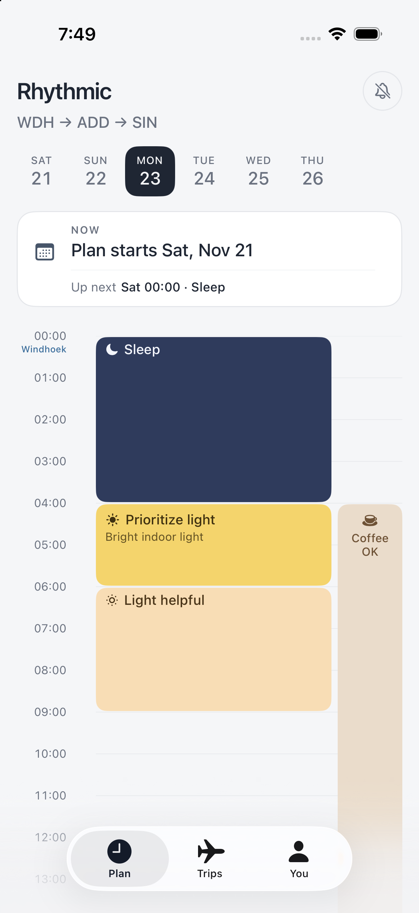
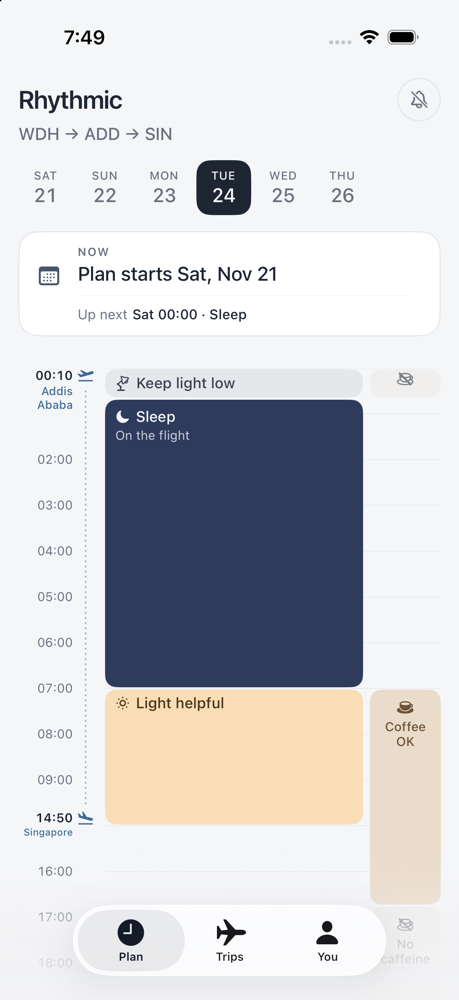
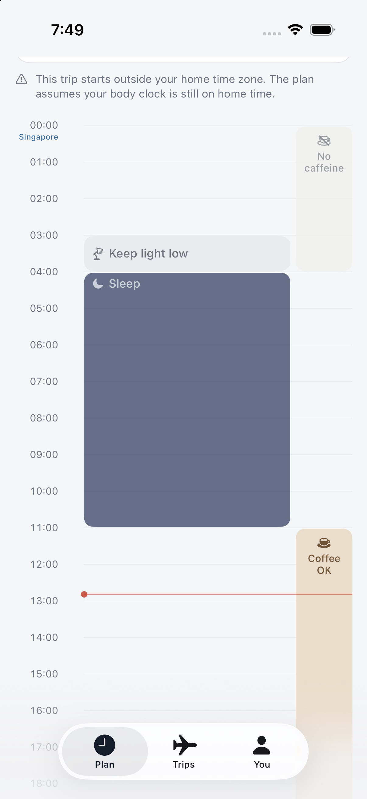
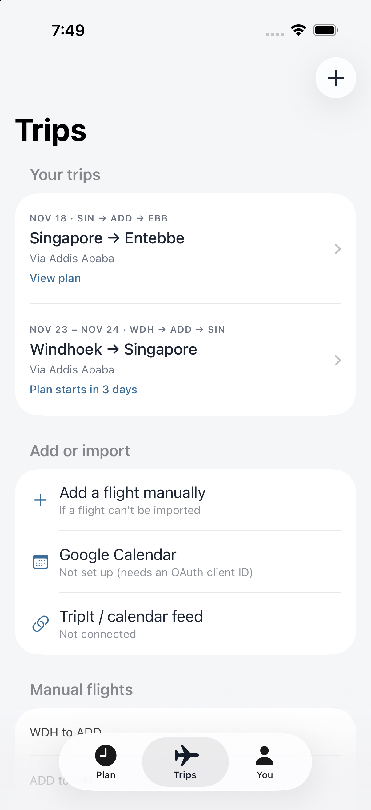
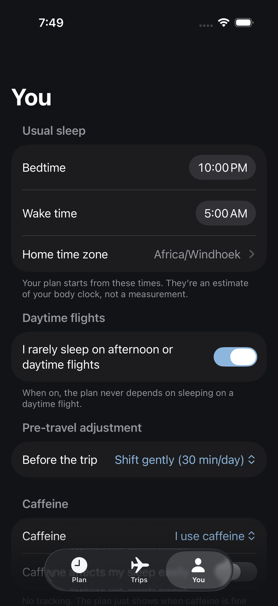
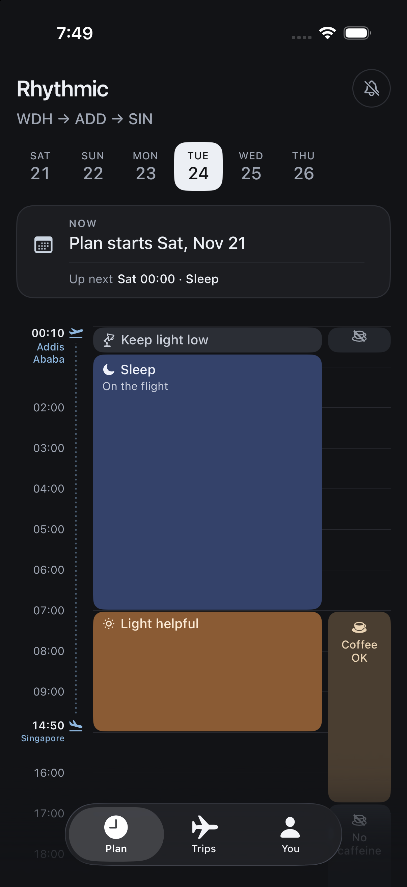

# Rhythmic

Circadian rhythm and jet-lag planning app for iPhone. It imports your flights and gives one clear, research-informed timeline: sleep, bright light, light reduction, optional naps, caffeine and wind-down, with concise reminders while the plan is active.

> Rhythmic offers research-informed suggestions based on your itinerary and usual sleep habits. It does not measure your body clock, provide medical advice, or guarantee results.

## Screenshots
Windhoek → Addis Ababa → Singapore, entered as test flights (iPhone Simulator, v0.2). The left-hand clock switches to Addis Ababa at landing and to Singapore at the next landing.

| Travel day | Transit & arrival | Current time |
|---|---|---|
|  |  |  |

| Trips | You (dark) | Dark mode |
|---|---|---|
|  |  |  |

## Docs
- [docs/PLAN.md](docs/PLAN.md): product decisions and architecture
- [docs/EVIDENCE.md](docs/EVIDENCE.md): every scheduling rule with source, basis, assumptions and review date
- [docs/IMPORT.md](docs/IMPORT.md): Google Calendar and TripIt feed import, plus setup

## Layout
- `RhythmicCore/`: Swift package with the scheduling engine, itinerary normalisation, notification planning and tests
- `App/`: SwiftUI iOS app (`App/Rhythmic.xcodeproj`)

## Build & test
Requires Xcode 16+ selected as the developer directory (`sudo xcode-select -s /Applications/Xcode.app/Contents/Developer`).

```bash
cd RhythmicCore && swift test             # engine tests
swift run rhythmic-cli east               # print the demo plan (also: west, --flights-ok)
open ../App/Rhythmic.xcodeproj            # run on a simulator or iPhone
```
Before installing on a device, change the bundle id (`com.example.rhythmic`) and pick your signing team in Xcode.

Debug builds accept `-RhythmicTab trips|you`, `-RhythmicDay <index>` and `-RhythmicScrollHour <n>` launch arguments so screens can be captured without gestures. They're compiled out of release builds. The app always uses the real current time.

## Status (v0.2, 2026-11-17)
**Works**
- Plan · Trips · You navigation. Plan shows the route, a day selector, the current action and a time-proportional timeline. The clock follows the most recently reached place and switches at each landing. Flight markers sit at their exact times and open flight details.
- Preferences → deterministic plan → timeline → local notification scheduling, from manually entered flights (plus the unvalidated feed and Google importers).
- Header bell and You tab both toggle reminders and reflect the real iOS permission.
- Light / Dark / System appearance, saved on the device.
- The "rarely sleep on afternoon flights" preference is applied before planning.
- Plans regenerate on itinerary or preference changes. Stale reminders are replaced; reminders stop at plan end or when disabled.
- Offline: the plan is stored locally and reminders are scheduled with iOS.

**Tested**
- 54 engine tests (Swift Testing), including timeline layout: landing-time clock switch, day paging across midnight, DST, fractional offsets and the date line, label collisions and lane continuity.
- Engine tests also cover the brief's time conversions, the westward 10:00 arrival, DST fall-back, fractional offsets, the date line, invariants across 9 scenarios, import dedupe/update/cancel/missing fields, and notification merging and staleness.
- App builds and renders in the iOS Simulator (checked by screenshot).

**Mocked / unvalidated**
- The Windhoek → Singapore and Singapore → Uganda trips are test fixtures used by the engine tests and the CLI. The app has no built-in sample trip.
- The TripIt feed parser has worked on one real feed (23 flights, 2026-11-17); the Google event parser has been tested only on synthetic samples.
- Google OAuth hasn't been run (needs a client ID).
- Notification delivery hasn't been observed on a device.

**Needs specialist review**
- All rules marked *Proposed default* in EVIDENCE.md.
- This is engineering validation only; nothing here is clinical validation.

## Licence
GPL-3.0 (see LICENSE). The bundled airport table (`RhythmicCore/Sources/RhythmicCore/Resources/airports.tsv`) is generated from [mwgg/Airports](https://github.com/mwgg/Airports), MIT licence (see `AIRPORTS-LICENSE.txt` beside it).
